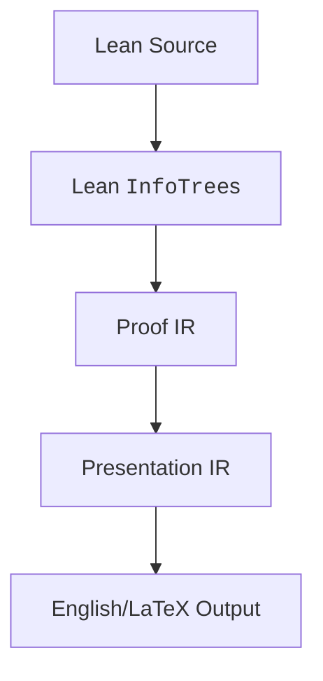

# Informalizer

Distill's informalizer is the system that translates formalized Lean proofs into human-readable English. Here is the general structure of how it works:

When Lean compiles a proof written in tactic mode, it uses [`InfoTree`](https://leanprover-community.github.io/mathlib4_docs/Lean/Elab/InfoTree/Types.html#Lean.Elab.InfoTree)s to document the tactics used to construct the proof term.

Using the `InfoTree` generated by a proof, we extract the necessary information from each tactic to form a Proof IR.

From this Proof IR, we convert every tactic, as well as the theorem statement, into a series of purely mathematical statements in Presentation IR.

We then perform a series of transformations to simplify the Presentation IR while preserving accuracy. After that we translate it directly into English.

More details about these steps are available in the rest of the documentation:
- How the Proof IR and Presentation IR work: [ir.md](ir.md)