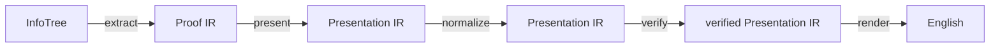

# The Pipeline

This file describes how a Lean proof becomes the English the level page shows, stage by stage, and where each stage can be extended. The intermediate representations themselves are described in [ir.md](ir.md).



| Stage | Function | Module |
|---|---|---|
| Extract | `extractProofs` | `Distill.Informalizer.Extract` (see [extraction.md](extraction.md)) |
| Present | `present` | `Distill.Informalizer.Present` |
| Normalize | `normalize` | `Distill.Informalizer.Normalize` |
| Verify | `verify` | `Distill.Informalizer.Verify` |
| Render | `render` | `Distill.Informalizer.Render` |

`informalize` in `Distill.Informalizer.Pipeline` runs the stages after extraction on one Proof IR, and `informalizeTree` runs all of them on the InfoTree of an elaborated command. Like extraction, the later stages work from InfoTrees alone and do not fail because of the proof they are given.

Every stage has a fallback, so the pipeline produces output for any proof. Supporting a construct means replacing a fallback with something better in the stage it belongs to.

Only a presentation that [`verify`](#verify) accepts is rendered, so the English a reader sees was written from a presentation that says what the Lean says. A presentation that does not verify is never shown; [Verify](#verify) says what is shown instead.

## Present

`present` builds the first Presentation IR of a proof. It says no more than the Proof IR does:

- **Statement.** Each binder of the statement becomes an object in a group of its own, or a hypothesis if it is a proof of a proposition. They stay in the order they were written, except that a hypothesis which a later binder is stated with becomes a property of the object before it. The conclusion is the goal the proof starts with.
- **Proof.** Each surface node becomes an `untranslated` step, in execution order. An `untranslated` step only names its node, and is shown as the Lean the user wrote. Its `evidence` is the part of the Lean proof the node is responsible for.

Translating a tactic means giving its node steps of other kinds here (`fix`, `assume`, `derive`, …).

## Normalize

Normalization is a sequence of *passes*. A pass rewrites a `PresentedDecl` into one that says the same thing and reads better. It does not produce English.

```lean
structure Pass where
  name : Name
  order : Nat := 500
  run : PresentedDecl → NormalizeM PresentedDecl
```

A pass can read the Proof IR, and runs with every hypothesis of the proof in the local context, so it can type-check and compare the expressions it sees.

Passes run in ascending `order`. Built-in passes are listed in `Distill.Informalizer.passes`. A library adds one without changing Distill:

```lean
@[distill_normalizer] def myPass : Pass where
  name := `MyLibrary.myPass
  run d := …
```

A pass that throws is skipped, so a pass only has to handle the proofs it was written for. A pass whose result does not verify is skipped too.

A pass must not change what the presentation says. It may:

- **Move things**: regroup objects, turn a hypothesis into a property of an object, reorder. An object can be introduced earlier or later than Lean binds it, as long as everything its type and properties mention is introduced before it.
- **Restate an expression** as one that reads better, recording the old expression in `MathExpr.history` (a `Restatement`). Without a proof the two must be definitionally equal; otherwise the pass gives a proof of `before = after` or `before ↔ after`.
- **Change steps**, taking their `evidence` along.

[`verify`](#verify) checks all of this. `#informalize` lists the passes that were skipped and why, so a test of a pass should show that it is not among them.

### Built-in passes

| Pass | Order | What it does |
|---|---|---|
| `membershipAsProperty` | 100 | (An instance of `hypothesesAsProperties`.) A hypothesis `x ∈ S` about an object `x` becomes a property of `x`, so the two are introduced together ("let $x \in S$"). If `x` is bound before `S`, it is moved after it. |
| `groupObjects` | 900 | Objects with the same type and the same properties are put in one group ("let $A$, $B$ and $C$ be sets", "let $x, y \in A$"), even when other binders separate them. |

## Render

`render` writes the Presentation IR as English: a few sentences for the statement and one piece of text per step. The text is a `Text` (`lean/Distill/Informalizer/Text.lean`), not a string: a tree whose leaves are words, LaTeX formulas and Lean code. Whoever shows it decides how to lay those out, and the tree leaves room for nodes that carry data about a part of a sentence, which interactive output will need. Over RPC it is a list of `{kind, text}` parts; `Text.toMarkup` flattens it to a string with `$…$` and `` `…` `` for tests and logs.

Rendering only decides wording. What is said, and in which order, was decided by the Presentation IR.

### Statements

The statement introduces the object groups in order, then states the hypotheses and the conclusion:

> Theorem. Let $A$, $B$ and $C$ be sets. If $C \subseteq A$ and $C \subseteq B$, then $C \subseteq A \cap B$.

- A group is introduced by its noun ("let $A$ and $B$ be sets"), or by its membership property alone ("let $x, y \in A$"). In general the clause is "let *names* be *article* *adjectives* *noun* with *accessories* such that *clauses*": a property of the objects is an adjective or an accessory if a translator says it as one, and a clause after "such that" otherwise.
- An implicit object (`{α : Type}`) is introduced only if the rest of the text names it or it has properties. A set is then "a set of elements of $\alpha$" instead of "a set".
- Hypotheses that are plain formulas are joined into "If … and …, then …". Otherwise they are stated as "Suppose that … and that …. Then …".
- Only a proof of a proposition has a statement: `def n : Nat := by …` has steps and nothing else.

### Expressions

The ontology of a statement is that of Kyle Miller's informalizer ([talk](https://kmill.github.io/informalization/ucsc_cse_talk.pdf)): *entities*, each described by a *noun*, *adjectives* and *accessories*. It is split over two stages:

- The entities are the Presentation IR's: a `MathObject`, with the hypotheses that are about it as its `properties`. Which hypotheses those are is decided in normalization. `Normalize.hypothesesAsProperties` does the moving for a pass that says which object a proposition is about; the built-in `membershipAsProperty` is one such pass, and a library writes another for its own predicates.
- The words are rendering's. An expression can be written as more than one *kind of phrase*, and a *translator* says how to write the expressions headed by one constant as one kind. The built-in renderer asks for these kinds:

| Kind | For | Result | Example |
|---|---|---|---|
| `Math` | any expression | a LaTeX formula with its precedence | `A ∩ B` ⟶ `A \cap B` |
| `Noun` | a type | what its elements are called | `Set α` ⟶ "a set", "sets" |
| `Adjective` | a property of an object | a word before the noun | `Injective f` ⟶ "an *injective* function" |
| `Accessory` | a property of an object | what the object comes with | `DecidableEq α` ⟶ "a type *with decidable equality*" |
| `Prose` | a proposition | a clause | `p ∧ q` ⟶ "$p$ and $q$" |

There are built-in translators for math, nouns and prose only: the demo levels have no adjectives or accessories, so those two kinds have a place in the grammar and no vocabulary yet. A translator for either must return `none` unless the proposition is about `RenderContext.subject?`, the object being described; the renderer itself only rules out a property that does not mention the object at all.

The kinds are not a fixed list: a kind is any type with a `TypeName`. English that needs more (a verb, a relation between objects, the vocabulary of proof steps) gets a new type, translators made with `Translator.of`, and callers that ask for it with `Renderer.phrase?`. Nothing about the existing kinds or translators changes. `Tests/Informalization/Extensibility.lean` uses adjectives and accessories and adds a kind of its own.

A proposition is written by its prose translator if it has one, else as a formula, else as Lean code. A formula is all or nothing: if any part of an expression has no LaTeX, the whole expression is shown as code.

The built-in translators (`Distill.Informalizer.Render.Expr`) cover the constructs of the demo levels:

| Construct | Rendering |
|---|---|
| `Set α` | "a set", or "a set of elements of $\alpha$" / "a set of sets" when the elements are named |
| `Type`, `Prop` | "a type", "a proposition" |
| any other type `T` | "an element of $T$", or "a term of type `T`" if `T` has no formula |
| `x ∈ S`, `A ⊆ B`, `A ∩ B`, `A ∪ B`, `a = b` | `x \in S`, `A \subseteq B`, `A \cap B`, `A \cup B`, `a = b`; `∩` and `∪` are parenthesized when mixed |
| `{x \| p x}` | `\{x \mid p\}` |
| `p ∧ q`, `p ∨ q` | "$p$ and $q$", "$p$ or $q$"; `\land`, `\lor` inside a formula or when the two are mixed. An "or" clause is never listed with "and" |
| `p → q` | "if $p$, then $q$"; `\to` inside a formula |
| `∀ x, p x` | "for every set $S$, …", "for all sets $S$ and $T$, …", and "for every $x \in A$, …" for `∀ x, x ∈ A → …`; `\forall x \in A,\ …` inside a formula |
| a variable | its name: `α` ⟶ `\alpha`, `h₁` ⟶ `h_{1}`, `hAB` ⟶ `\mathit{hAB}` |

A library adds translators for its own definitions without changing Distill. Each is handed a `Renderer` to write subexpressions with, and returns `none` for an expression it does not handle, in which case the next translator of that kind for the constant is tried. `r.math` records which variables the text names; a translator that writes a variable's name itself calls `mention`, or an implicit object it names is not introduced.

```lean
@[distill_translator Set.compl] def mathCompl : Translator := .math fun r e => do
  unless e.isAppOfArity ``Set.compl 2 do return none
  let some a ← r.math e.appArg! | return none
  return some { tex := s!"{a.at 1024}^c", prec := 1023 }

@[distill_translator Disjoint] def proseDisjoint : Translator := .prose fun r e => do
  let some a ← r.math (e.getArg! 1) | return none
  let some b ← r.math (e.getArg! 2) | return none
  return some { text := a.text ++ " and " ++ b.text ++ " are disjoint" }

@[distill_translator Nat] def nounNat : Translator := .noun fun _ _ =>
  return some { singular := "natural number", plural := "natural numbers" }
```

### Steps

Proof steps are still rendered by the fallback, which shows the Lean:

> Apply `intro x hx`.

## Verify

`verify` checks a `PresentedDecl` against the Proof IR it came from, with Lean's type checker. It is to the Presentation IR what the proof term check of `#proof_ir` is to the Proof IR.

- **Statement.** The presented statement is `∀ objects and their properties, hypotheses → conclusion`, in the order the presentation introduces them. It has to be the original statement: the same term, definitionally equal, or equivalent by a proof of `original ↔ presented` that `verify` builds and type-checks. That proof reorders the binders, and uses the proofs recorded in `MathExpr.history` where a hypothesis or the conclusion was restated.
- **Proof.** The `evidence` of the steps has to add up to a term that, carried over the equivalence, proves the presented statement. Only the sum is checked: not which step carries which piece, and not that every tactic of the proof has a step. So `verify` vouches for the statement, and for the steps only that together they are a proof.
- **Structure.** What rendering reads besides expressions has to be right: the objects of a group are described the same way, and objects and the declaration appear under their own names and label.

A presentation that drops a hypothesis, restates something as a statement that is not equivalent, or loses the evidence of a step does not verify. A restatement whose proof contains `sorry` does not verify either.

An unfinished proof is not a wrong presentation: the steps may leave open what the Lean proof leaves open (a goal nothing closes, a goal a failed tactic left to `sorry`, a `sorry` the user wrote), and the proof is then reported as incomplete. What the steps do prove is still type-checked, with each hole as a `sorry`.

`informalize` verifies every presentation before rendering it:

1. The normalized presentation is verified. Normally it passes, and is rendered.
2. If it fails, the presentation from `present` is verified, and the passes are run again with a check after each one. A pass whose result does not verify is left out (`Informalized.skipped`), and the rest is rendered.
3. If the presentation from `present` fails too, what failed is not translated: the steps are shown as the Lean they are, and so is the statement unless the statement check passed.

If verification itself does not finish (it runs out of heartbeats, say), everything is shown as Lean.

`Informalized.verification?` holds what `verify` found for the presentation that was used.

`verify` type-checks whole proof terms. On the demo levels and on a file of 402 theorems like them, this roughly doubles the time of the stages after extraction, which stays under a tenth of what Lean takes to elaborate the file. `Config.verify := false` turns it off, for measuring the other stages.

It does not support restating the *type* of an object other than definitionally.

## The web app

The level page calls the RPC method `Distill.translate` (`lean/Distill/Translate.lean`) through the editor's language server connection once Lean has checked the document. It runs the pipeline on the InfoTree of every command and returns the English line by line: a theorem's statement at the line of its name, and each step at the line its tactic starts on. Each line's English is a list of `{kind, text}` parts, which the page lays out.

## Inspecting and testing

`#informalize` before a command prints what the pipeline made of its proofs: the Presentation IR (after normalization), the English, what `verify` found, and the passes that were skipped, with lines relative to the command. `#informalize_statement` prints only the English statement and how the presented statement relates to the original.

```lean
import Distill.Informalizer.Frontend

#informalize
theorem t (p q : Prop) (hp : p) (hq : q) : p ∧ q := by
  exact ⟨hp, hq⟩
```

The golden tests in `lean/Tests/Informalization` use them on proofs and statements of different shapes and on passes and translators from a library, and run the whole pipeline on the demo levels the way the web app does. Run them with `lake test` in `lean/`. When the output changes on purpose, update the docstring above the affected `#guard_msgs`.
