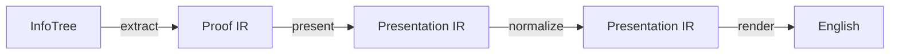

# The Pipeline

This file describes how a Lean proof becomes the English the level page shows, stage by stage, and where each stage can be extended. The intermediate representations themselves are described in [ir.md](ir.md).



| Stage | Function | Module |
|---|---|---|
| Extract | `extractProofs` | `Distill.Informalizer.Extract` (see [extraction.md](extraction.md)) |
| Present | `present` | `Distill.Informalizer.Present` |
| Normalize | `normalize` | `Distill.Informalizer.Normalize` |
| Render | `render` | `Distill.Informalizer.Render` |

`informalize` in `Distill.Informalizer.Pipeline` runs the last three on one Proof IR, and `informalizeTree` runs all four on the InfoTree of an elaborated command. Like extraction, the later stages work from InfoTrees alone and do not fail because of the proof they are given.

Every stage has a fallback, so the pipeline produces output for any proof. Supporting a construct means replacing a fallback with something better in the stage it belongs to.

## Present

`present` builds the first Presentation IR of a proof. It says no more than the Proof IR does:

- **Statement.** Each binder of the statement becomes an object, or a hypothesis if it is a proof of a proposition. They stay in the order they were written. The conclusion is the goal the proof starts with.
- **Proof.** Each surface node becomes an `untranslated` step, in execution order. An `untranslated` step only names its node, and is shown as the Lean the user wrote.

Translating a tactic means giving its node steps of other kinds here (`fix`, `assume`, `derive`, …).

## Normalize

Normalization is a sequence of *passes*. A pass rewrites a `PresentedDecl` into one that says the same thing and reads better. It does not produce English.

```lean
structure Pass where
  name : Name
  order : Nat := 500
  run : PresentedDecl → NormalizeM PresentedDecl
```

A pass can read the Proof IR, and runs with every hypothesis of the proof in the local context, so it can type-check and compare the expressions it sees.

Passes run in ascending `order`. Built-in passes are listed in `Distill.Informalizer.passes`. A library adds one without changing Distill:

```lean
@[distill_normalizer] def myPass : Pass where
  name := `MyLibrary.myPass
  run d := …
```

A pass that throws is skipped, so a pass only has to handle the proofs it was written for.

There are no built-in passes yet.

## Render

`render` writes the Presentation IR as English: a few sentences for the statement and one piece of text per step. The text is a `Text` (`lean/Distill/Informalizer/Text.lean`), not a string: a tree whose leaves are words, LaTeX formulas and Lean code. Whoever shows it decides how to lay those out, and the tree leaves room for nodes that carry data about a part of a sentence, which interactive output will need. Over RPC it is a list of `{kind, text}` parts; `Text.toMarkup` flattens it to a string with `$…$` and `` `…` `` for tests and logs.

For now everything is rendered by the fallback, which shows the Lean:

> Theorem. Let `α : Type u_1`, `A : Set α` and `B : Set α`. Then `A ∩ B ⊆ A`.
>
> Apply `intro x hx`.

## The web app

The level page calls the RPC method `Distill.translate` (`lean/Distill/Translate.lean`) through the editor's language server connection once Lean has checked the document. It runs the pipeline on the InfoTree of every command and returns the English line by line: a theorem's statement at the line of its name, and each step at the line its tactic starts on.

## Inspecting and testing

`#informalize` before a command prints the Presentation IR (after normalization) and the English of its proofs, with lines relative to the command:

```lean
import Distill.Informalizer.Frontend

#informalize
theorem t (p q : Prop) (hp : p) (hq : q) : p ∧ q := by
  exact ⟨hp, hq⟩
```

The golden tests in `lean/Tests/Informalization` use it on proofs of different shapes, and run the whole pipeline on the demo levels the way the web app does. Run them with `lake test` in `lean/`. When the output changes on purpose, update the docstring above the affected `#guard_msgs`.
